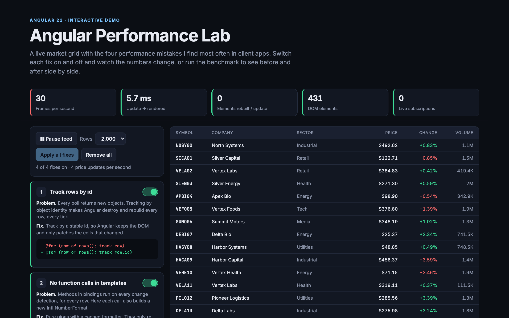
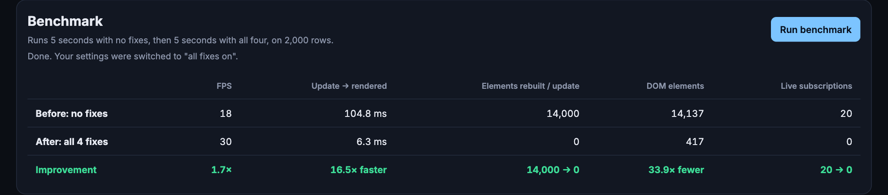

# Angular Performance Lab

An interactive Angular 22 demo of the four performance mistakes I find most often in client apps. A live market grid gets 4 price updates per second. Switch each fix on and off and watch frames per second, render time, DOM size and live subscriptions change, or run the built-in benchmark for a before/after table.

**Live demo:** https://angular-performance-lab.vercel.app



## Benchmark (2,000 rows, headless Chrome on a MacBook)

| | Before: no fixes | After: all 4 fixes | |
|---|---|---|---|
| Update → rendered | ~100 ms | ~6 ms | **~17× faster** |
| Elements rebuilt per update | 14,000 | 0 | rows patched in place |
| DOM elements | ~14,100 | ~420 | **~34× fewer** |
| Live subscriptions after 20 panel open/close | 20 | 0 | leak fixed |

Click **Run benchmark** on the page to reproduce it in your own browser.



## The four fixes

| # | Problem | Fix |
|---|---|---|
| 1 | Polling returns new objects, and `@for (row of rows(); track row)` tracks by identity, so Angular destroys and rebuilds every row on every update. | `track row.id` keeps the DOM and patches only changed text. |
| 2 | Template method calls (`{{ formatPrice(row) }}`) run on every change detection for every row, each one building a new `Intl.NumberFormat`. | Pure pipes with cached formatters (`row.price \| price`). |
| 3 | All rows live in the DOM even though ~20 are visible. | CDK `cdk-virtual-scroll-viewport`. |
| 4 | A side panel subscribes to the price feed and never unsubscribes; every open/close leaves a subscription that keeps sorting the whole market. | `takeUntilDestroyed()`. |

## How it's measured

- **Update → rendered**: time from the price update to the end of Angular's render (`afterEveryRender`), averaged over the last 20 updates.
- **Elements rebuilt / update**: elements inserted into the grid per update, counted with a `MutationObserver`.
- **DOM elements**, **FPS**: sampled once a second with `requestAnimationFrame`.
- **Live subscriptions**: the feed's `Observable` counts subscribers in its subscribe/teardown logic.

## Tests

15 unit tests (Vitest), including:
- the grid **rebuilds every row** when tracking by identity and **reuses every row element** when tracking by id
- methods and pure pipes render identical text
- the panel **leaks one subscription per open/close** without fix 4, and **none** with it

## Project structure

```
src/app/
├── core/
│   ├── market.ts        # seeded market data + polling feed with a subscriber counter
│   ├── metrics.ts       # FPS, render time, inserted elements, DOM size
│   ├── format.ts        # pure pipes with cached Intl formatters
│   └── lab-settings.ts  # the four fixes (signals)
├── lab/
│   ├── market-grid.*    # the grid: @for vs CDK virtual scroll, methods vs pipes
│   └── detail-panel.ts  # "top movers" panel, the leak demo
└── app.*                # metrics bar, fix toggles, benchmark runner
```

## Run it locally

```bash
npm install
npm start          # http://localhost:4200
npm test           # 15 unit tests
npm run build
```

---

Built by **Ahmed Magdy**, a senior Angular developer who fixes slow Angular apps, memory leaks and change-detection problems, and does version upgrades and AngularJS migrations. [GitHub](https://github.com/AhmedMagdyy1) · [Upwork](https://www.upwork.com/freelancers/~01a957fdca72010059)
